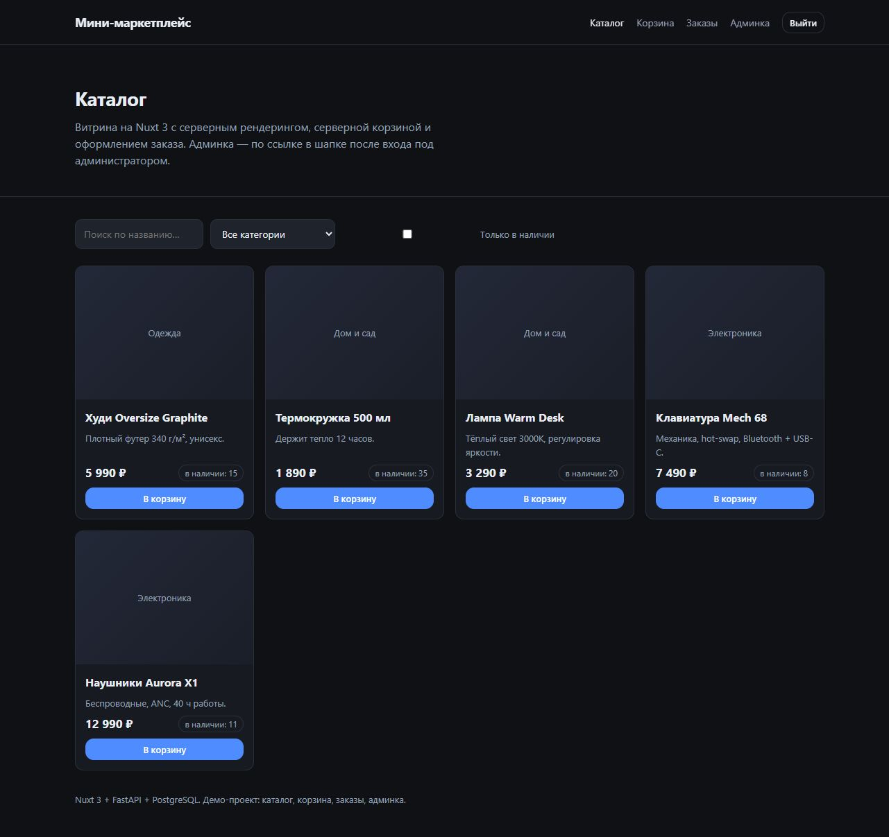
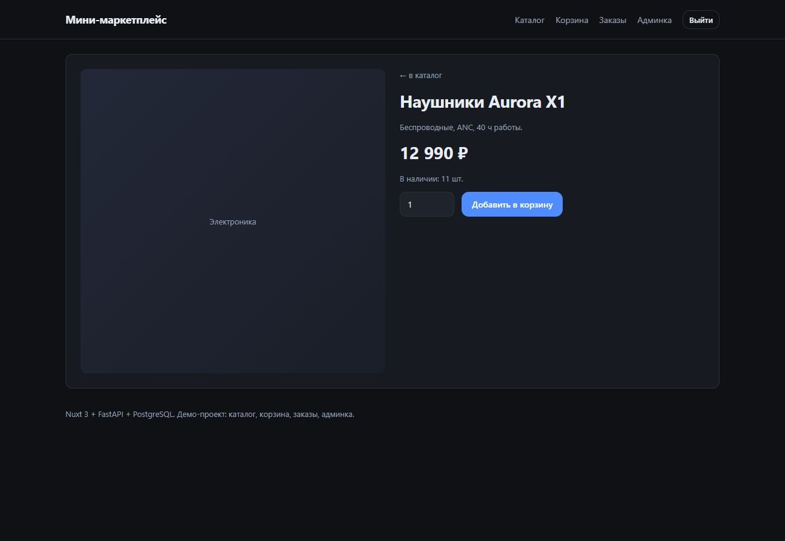
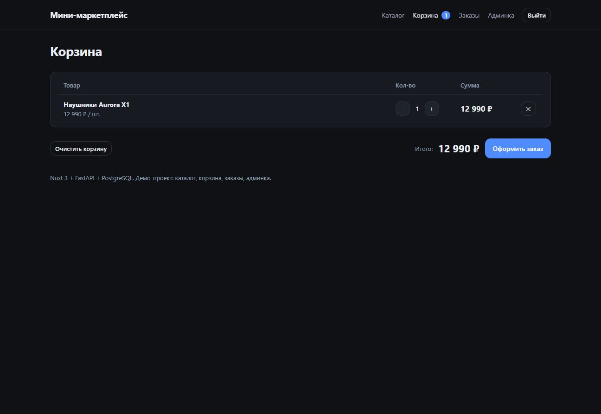
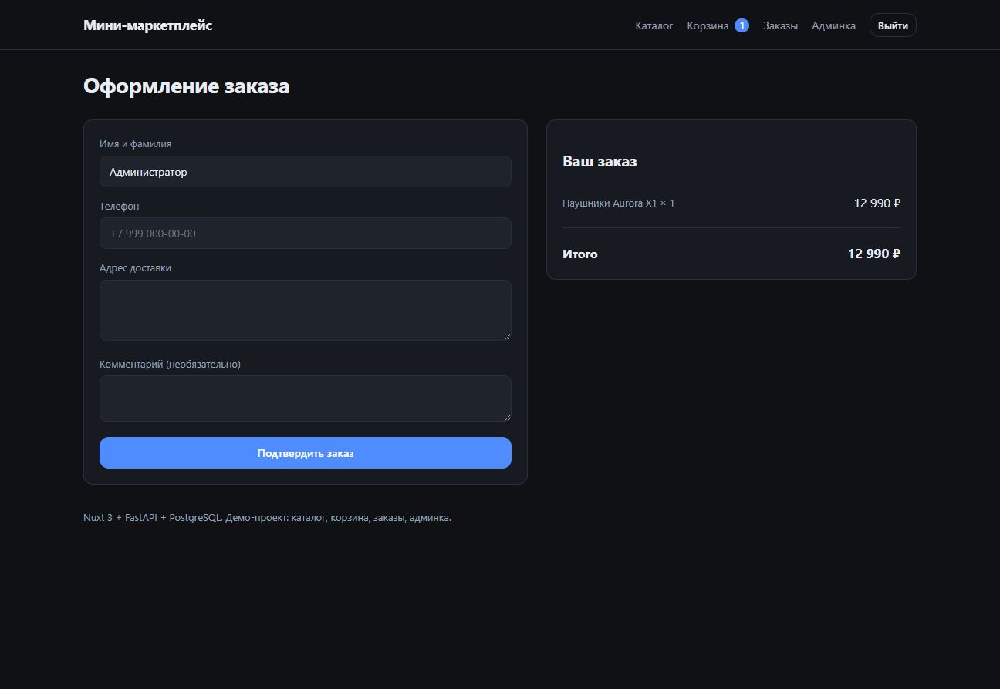
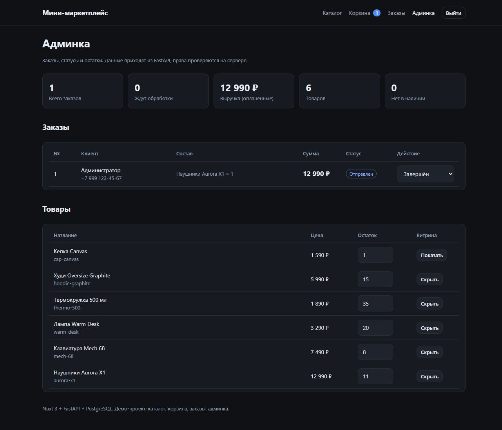

# Мини-маркетплейс

[](https://github.com/kurunka/marketplace/actions/workflows/ci.yml)

Демо-маркетплейс с каталогом, серверной корзиной, оформлением заказов и админкой.
Полный цикл на одном стеке: **Nuxt 3 + TypeScript** → **nginx** → **FastAPI** → **PostgreSQL**.

Проект собран как портфолио-демонстрация: показывает не макет, а работающий продукт
с транзакциями, проверкой остатков, ролевым доступом, миграциями и CI.



<table>
<tr>
<td width="50%"></td>
<td width="50%"></td>
</tr>
<tr>
<td width="50%"></td>
<td width="50%"></td>
</tr>
</table>

---

## Что умеет

**Витрина**
- каталог с поиском, фильтром по категории, цене и наличию, пагинацией;
- карточка товара с отдельным URL (`/product/aurora-x1`) — SSR, поэтому индексируется;
- корзина на сервере: переживает смену устройства и очистку браузера.

**Заказ**
- оформление из корзины одной транзакцией;
- остаток списывается под блокировкой строки (`SELECT … FOR UPDATE`) — два параллельных
  заказа не продадут последнюю единицу;
- в позиции заказа сохраняется снимок названия и цены: правка цены в админке не переписывает историю;
- корзина очищается только после успешного создания заказа.

**Админка** (`/admin`, только роль `admin`)
- сводка: заказы, выручка по оплаченным, товары, позиции без остатка;
- список заказов и перевод статусов по разрешённому графу
  (`pending → paid → shipped → done`, отмена из `pending`/`paid`);
- остатки и видимость товара правятся на месте;
- удаление товара — мягкое (`is_active = false`), чтобы не ломать старые заказы.

**Инфраструктура**
- `docker compose up` поднимает четыре сервиса: PostgreSQL, backend, frontend, nginx;
- Alembic-миграции применяются при старте контейнера;
- nginx: reverse proxy, gzip, кэш статики, security-заголовки;
- GitHub Actions: ruff + pytest → typecheck + build → сборка образов → smoke-тест
  поднятого compose-стека с проверкой `/api/health`.

---

## Стек

| Слой | Технологии |
|---|---|
| Frontend | Nuxt 3, Vue 3 (Composition API), TypeScript, Pinia, SSR |
| Backend | FastAPI, Pydantic v2, SQLAlchemy 2 (async), Alembic, PyJWT, bcrypt |
| БД | PostgreSQL 16, asyncpg |
| Инфраструктура | Docker, docker-compose, nginx, GitHub Actions |
| Тесты | pytest, pytest-asyncio, httpx (ASGI), SQLite для быстрых прогонов |

---

## Архитектура

```
            браузер
               │
               ▼
        ┌─────────────┐
        │    nginx    │  :80
        │  /api/  ────┼──────────────┐
        │  /      ────┼───────┐      │
        └─────────────┘       │      │
                              ▼      ▼
                    ┌──────────┐  ┌──────────────┐
                    │  Nuxt 3  │  │   FastAPI    │
                    │  :3000   │  │    :8000     │
                    │   SSR    │  │  REST /api   │
                    └──────────┘  └──────┬───────┘
                                         │ asyncpg
                                         ▼
                                  ┌──────────────┐
                                  │ PostgreSQL   │
                                  │    :5432     │
                                  └──────────────┘
```

Nuxt рендерит каталог на сервере и ходит в API по внутреннему адресу `http://backend:8000`
(контейнерная сеть), а браузер — через nginx по `/api`. JWT лежит в http-cookie, поэтому
SSR-запросы тоже авторизованы.

---

## Быстрый старт

Нужен только Docker.

```bash
cp .env.example .env      # при желании поменяйте пароли и SECRET_KEY
docker compose up --build
```

Открыть:

| Что | Адрес |
|---|---|
| Витрина | http://localhost |
| Swagger | http://localhost/docs |
| Админка | http://localhost/admin |

Демо-доступ администратора задаётся в `.env`:

```
ADMIN_EMAIL=admin@example.com
ADMIN_PASSWORD=admin12345
```

При первом старте создаются администратор, 3 категории и 6 товаров (идемпотентно —
повторный запуск ничего не дублирует).

Остановить и удалить данные:

```bash
docker compose down -v
```

---

## Разработка без Docker

**Backend**

```bash
cd backend
python -m venv .venv
.venv/Scripts/activate          # Windows
# source .venv/bin/activate     # Linux / macOS
pip install -r requirements-dev.txt

# для локального запуска достаточно SQLite
set DATABASE_URL=sqlite+aiosqlite:///./dev.sqlite3
python -c "import asyncio; from app.db import Base, engine; asyncio.run(engine.begin().__aenter__())"  # необязательно

uvicorn app.main:app --reload
```

**Frontend**

```bash
cd frontend
npm install
npm run dev        # http://localhost:3000
```

`NUXT_PUBLIC_API_BASE` должен указывать на API (по умолчанию `http://localhost/api`,
при локальной разработке без nginx — `http://localhost:8000/api`).

---

## Тесты и линтеры

```bash
cd backend
pip install -r requirements-dev.txt
ruff check app tests
pytest            # 7 тестов, SQLite, ~3 секунды
```

Покрыто поведением, а не строками:

| Тест | Что проверяет |
|---|---|
| `test_register_login_me` | регистрация, логин, неверный пароль → 401 |
| `test_catalog_filtering` | поиск, фильтр «в наличии», карточка по slug |
| `test_cart_respects_stock` | нельзя положить в корзину больше, чем на складе (409) |
| `test_checkout_decrements_stock_and_clears_cart` | заказ списывает остаток, корзина пустеет |
| `test_checkout_empty_cart_rejected` | пустая корзина → 400 |
| `test_admin_guard_and_status_transitions` | покупатель → 403; недопустимый переход статуса → 409 |

```bash
cd frontend
npm run typecheck
npm run build
```

Всё это же прогоняется в CI на каждый push — четыре job'а: линтеры и тесты бэкенда,
типизация и сборка фронтенда, сборка Docker-образов, поднятие compose-стека
с проверкой `/api/health`.

---

## API

Все эндпоинты под `/api`. Авторизация — `Authorization: Bearer <token>`.

| Метод | Путь | Доступ | Назначение |
|---|---|---|---|
| `POST` | `/auth/register` | — | регистрация, возвращает JWT |
| `POST` | `/auth/login` | — | вход |
| `GET` | `/auth/me` | user | текущий пользователь |
| `GET` | `/categories` | — | список категорий |
| `GET` | `/products` | — | каталог: `q`, `category`, `min_price`, `max_price`, `in_stock`, `page`, `per_page` |
| `GET` | `/products/{slug}` | — | карточка товара |
| `GET` | `/cart` | user | корзина с суммой |
| `POST` | `/cart` | user | добавить товар |
| `PATCH` | `/cart/{item_id}` | user | изменить количество |
| `DELETE` | `/cart/{item_id}` | user | удалить позицию |
| `DELETE` | `/cart` | user | очистить корзину |
| `POST` | `/orders` | user | оформить заказ из корзины |
| `GET` | `/orders` | user | мои заказы |
| `GET` | `/orders/{id}` | user | заказ по id |
| `GET` | `/admin/stats` | admin | сводка |
| `GET` | `/admin/products` | admin | все товары, включая скрытые |
| `POST` | `/admin/products` | admin | создать товар |
| `PATCH` | `/admin/products/{id}` | admin | изменить товар / остаток |
| `DELETE` | `/admin/products/{id}` | admin | скрыть товар |
| `GET` | `/admin/orders` | admin | заказы, фильтр по статусу |
| `PATCH` | `/admin/orders/{id}` | admin | сменить статус |

---

## Структура

```
marketplace/
├─ docker-compose.yml          # db + backend + frontend + nginx
├─ nginx/nginx.conf            # reverse proxy, gzip, кэш, заголовки
├─ .github/workflows/ci.yml    # lint → tests → typecheck → build → smoke
├─ backend/
│  ├─ alembic/versions/0001_init.py
│  ├─ app/
│  │  ├─ main.py               # сборка приложения
│  │  ├─ config.py             # pydantic-settings
│  │  ├─ db.py                 # async engine, сессии
│  │  ├─ models.py             # User, Category, Product, CartItem, Order, OrderItem
│  │  ├─ schemas.py            # контракты API
│  │  ├─ security.py           # bcrypt + JWT
│  │  ├─ deps.py               # current user, admin guard
│  │  ├─ seed.py               # демо-данные, идемпотентно
│  │  └─ routers/              # auth, catalog, cart, orders, admin
│  └─ tests/test_api.py
└─ frontend/
   ├─ nuxt.config.ts
   ├─ composables/useApi.ts    # типизированный клиент, SSR-aware
   ├─ stores/                  # auth, cart (Pinia)
   ├─ pages/                   # index, product/[slug], cart, checkout, orders, login, admin
   ├─ components/ProductCard.vue
   └─ types/api.ts
```

---

## Решения, которые стоит объяснить

**Корзина на сервере, а не в localStorage.** Иначе гость с телефона и с ноутбука видит
разные корзины, а остатки проверить нечем. Цена — один лишний запрос на изменение.

**Списание остатков под `FOR UPDATE`.** Классическая ошибка интернет-магазинов: два человека
одновременно покупают последнюю единицу, оба получают «заказ принят», один товар.
Блокировка строки внутри транзакции закрывает это на уровне БД, а не кода.

**Снимок цены в позиции заказа.** `order_items.price` хранит цену на момент покупки.
Иначе подорожание товара задним числом меняет сумму старых заказов и бухгалтерию.

**Граф статусов на бэкенде.** UI рисует только разрешённые переходы, но правило живёт
в API: `pending → shipped` вернёт 409, даже если отправить запрос руками.

**Мягкое удаление товара.** `DELETE` ставит `is_active = false`. Жёсткое удаление
оставило бы заказы со ссылкой в никуда.

**SSR для каталога.** Клиентский рендеринг отдаёт поисковику пустой HTML. Каталог
и карточки приходят с сервера готовыми — это разница между «красиво» и «находится в поиске».

---

## Ограничения демо

Честный список того, чего здесь нет — чтобы не было сюрпризов:

- **оплата не подключена**: заказ создаётся в статусе `pending`, оплата — следующий этап
  (ЮKassa / T-Банк + вебхук);
- **нет загрузки изображений**: `image_url` — строка, картинки подставляются по ссылке;
- **нет ролей продавца**: один администратор на всю площадку, без разграничения по магазинам;
- **нет Redis и фоновых задач**: уведомления и отчёты — отдельный слой;
- **нет rate limiting**: для продакшена нужен лимит на `/auth/login` и `/orders`;
- **тесты на SQLite**: для честной проверки блокировок нужен прогон против PostgreSQL.

---

## Лицензия

MIT — используйте как основу для своих проектов.
